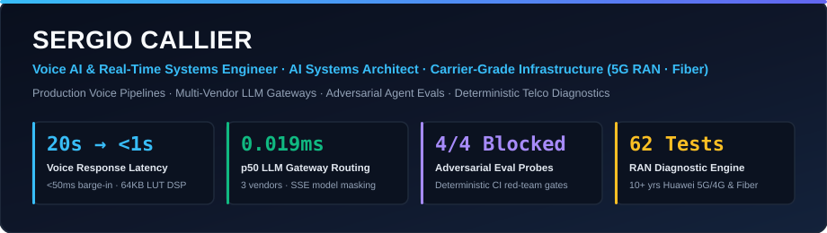
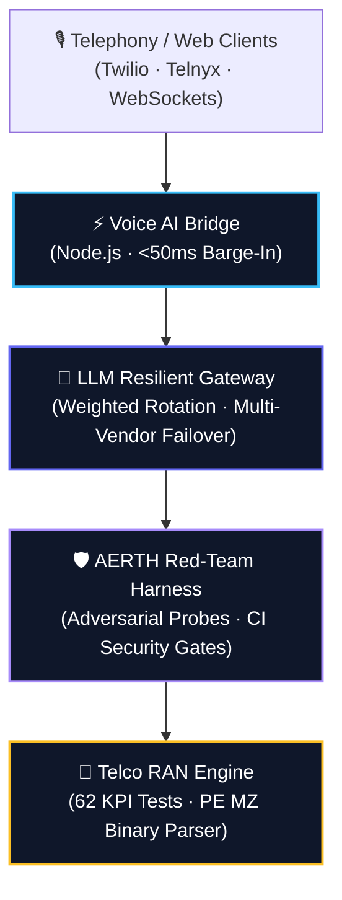

# Sergio Callier | Voice AI & Real-Time Systems Engineer — AI Systems Architect

### 💡 Engineering Vision & Systems Approach
Senior Real-time AI Systems Engineer specializing in low-latency voice streaming pipelines, multi-vendor LLM gateway resilience, and deterministic red-teaming evaluations. Grounded in 10+ years of carrier-grade access network engineering (Huawei 5G/4G RAN, RF, fiber optics).

- **Production Voice Latency:** Reduced end-to-end voice response latency from **20s to <1s** with **<50ms barge-in** interruption clearing for high-throughput telephony.
- **Resilient Multi-Vendor Gateways:** Designed zero-dependency weighted least-used key rotation (`RPM/RPD/TPM`) with instant failover (`Gemini → Groq → NVIDIA NIM`) and transparent SSE stream model masking.
- **Deterministic Evals & Red-Teaming:** Engineered automated adversarial evaluation harnesses blocking 4/4 attack categories in CI before production deployments.
- **Carrier-Grade Availability:** Applied telecom SLA rigor to software systems, maintaining zero single-point-of-failure architectures across distributed LLM workflows.

---

## 🌟 Featured Engineering Showcases

### 🎙️ [realtime-voice-ai-bridge](https://github.com/SerjCallier/realtime-voice-ai-bridge) — Sub-Second Voice AI & Media Stream Bridge

Sub-second bidirectional audio streaming server for real-time Voice AI applications. Built with pure native Node.js (zero external npm dependencies).
- **Architecture Highlights:** O(1) 64KB Mu-Law LUT DSP resampler (`p95 0.03ms/frame`), instant `<50ms` barge-in audio buffer clearing, non-blocking text marker "Ghost Tools" for mid-stream function execution, and Twilio/Telnyx WebSocket failover.
- **Production Performance:** Cut conversational latency from 20s to <1s; verified with 8/8 native integration tests in CI.

---

### ⚡ [llm-resilient-rotate-gateway](https://github.com/SerjCallier/llm-resilient-rotate-gateway) — Resilient Multi-Vendor LLM Gateway

Zero-dependency OpenAI-compatible HTTP/SSE gateway designed for maximum availability and cost efficiency across rate-limited API tiers.
- **Architecture Highlights:** Weighted least-used API key rotation pool balancing RPM, RPD, and TPM limits; automatic timezone cooldowns (Pacific midnight reset, 60s window, 5s backoff); transparent multi-vendor fallback (`Gemini → Groq → NVIDIA NIM`); and dynamic SSE stream model masking.
- **Production Performance:** Benchmarked at `p50 0.0192ms` / `p95 0.0946ms` overhead; 9/9 automated tests passing in CI.

---

### 🛡️ [agent-evals-redteam-harness](https://github.com/SerjCallier/agent-evals-redteam-harness) — AERTH: AI Agent Evals & Red-Teaming Harness

Deterministic evaluation and adversarial security testing framework for production LLM agents and multi-tool pipelines.
- **Architecture Highlights:** Reproducible test runner enforcing exact-match assertions, tool-calling signature accuracy scoring, and CI-integrated red-teaming probes protecting against prompt injection, DAN jailbreaks, PII leaks, and destructive tool hijacking.
- **Security Impact:** 100% CI security gate enforcement preventing unsafe models or compromised prompts from reaching production.

---

### 📡 [telco-ran-ai-engine](https://github.com/SerjCallier/telco-ran-ai-engine) — 4G/5G RAN Deterministic KPI Diagnostic Engine

Deterministic root-cause diagnostic engine for cellular access networks (4G LTE / 5G NR) combining physical binary parsing with hybrid RAG.
- **Architecture Highlights:** Binary PE MZ header validation on proprietary telecom trace files to prevent corrupted inference, paired with BM25 hybrid vector search to retrieve zero-hallucination field remediation runbooks.
- **Verification:** 62/62 automated pytest cases and ruff linting enforcing carrier-grade SLA standards.

---

### 🛠️ Supporting Engineering Repositories
- 🗺️ **[AI-Systems-Architecture-Showcase](https://github.com/SerjCallier/AI-Systems-Architecture-Showcase):** Async Puppeteer Google Maps lead scraper, n8n human-in-the-loop workflows, and CommIntel MCP integration.
- 📊 **[ai-system-builder-showcase](https://github.com/SerjCallier/ai-system-builder-showcase):** AI Revenue Attribution & Lead Analytics Engine (Async Python + SQLAlchemy + LiteLLM + PostgreSQL).
- 📅 **[klierbook](https://github.com/SerjCallier/klierbook):** Zero-subscription SaaS booking engine (React 19 + TypeScript + Tailwind + n8n webhooks).

---

## 🛠️ Tech Stack & Systems Expertise

| Domain | Technologies & Frameworks |
| :--- | :--- |
| **Real-Time Voice & Audio DSP** |      |
| **AI Infrastructure & Gateways** |       |
| **Backend & Databases** |       |
| **Testing, Security & DevOps** |      |
| **Telecom & Physical Networks** |     |

---

## 📈 Engineering Activity & Insights

  
  

---

## 📬 Contact & Links

- 💼 **LinkedIn:** [linkedin.com/in/sergio-callier-578b71a3](https://www.linkedin.com/in/sergio-callier-578b71a3)
- 📧 **Email:** [callier.sergio@gmail.com](mailto:callier.sergio@gmail.com)
- 🐙 **GitHub Profile:** [github.com/SerjCallier](https://github.com/SerjCallier)

---

🇦🇷 Versión en Español (Perfil Técnico Completo)

 

# Sergio Callier | Ingeniero de Sistemas Voice AI & Tiempo Real — Arquitecto de Sistemas IA

### 💡 Visión de Ingeniería y Enfoque de Sistemas
Ingeniero Senior de Sistemas de IA en Tiempo Real especializado en pipelines de streaming de voz de baja latencia, resiliencia de gateways LLM multi-proveedor y evaluación determinista de seguridad agéntica (*red-teaming*). Con más de 10 años de trayectoria en ingeniería de redes de acceso de telecomunicaciones de grado carrier (Huawei 5G/4G RAN, RF, fibra óptica).

- **Latencia de Voz en Producción:** Reducción de la latencia de respuesta de voz de **20s a <1s** con manejo de interrupción (*barge-in*) en **<50ms** para operaciones de alto tráfico telefónico.
- **Gateways Multi-Proveedor Resilientes:** Diseño de pools de rotación ponderada de API keys (`RPM/RPD/TPM`) sin dependencias externas, con failover instantáneo (`Gemini → Groq → NVIDIA NIM`) y enmascaramiento transparente de modelos en streams SSE.
- **Red-Teaming y Evals Deterministas:** Harness de evaluación automatizada con 4/4 categorías de ataques adversariales bloqueados en CI antes de despliegues a producción.
- **Disponibilidad de Grado Carrier:** Aplicación del rigor de SLAs de telecomunicaciones al diseño de software, manteniendo arquitecturas sin puntos únicos de falla (*zero single-point-of-failure*).

---

### 🌟 Demostraciones Principales de Ingeniería

#### 🎙️ [realtime-voice-ai-bridge](https://github.com/SerjCallier/realtime-voice-ai-bridge) — Bridge de Voz IA & Streaming en Tiempo Real (<1s)
Servidor de streaming de audio bidireccional sub-segundo para aplicaciones de Voice AI. Desarrollado en Node.js nativo (cero dependencias npm externas).
- **Aspectos Arquitectónicos:** Resampler DSP Mu-Law LUT 64KB en O(1) (`p95 0.03ms/frame`), limpieza instantánea del buffer de audio en `<50ms` ante interrupción (*barge-in*), marcadores "Ghost Tools" para ejecución de funciones sin bloquear el stream, y failover de WebSockets para Twilio y Telnyx.
- **Rendimiento en Producción:** Reducción de latencia conversacional de 20s a <1s; verificado con 8/8 tests de integración en CI.

#### ⚡ [llm-resilient-rotate-gateway](https://github.com/SerjCallier/llm-resilient-rotate-gateway) — Gateway LLM Multi-Proveedor Resiliente
Proxy HTTP/SSE compatible con OpenAI, sin dependencias externas, optimizado para máxima disponibilidad y eficiencia de costos en proveedores con límites de tasa (rate limits).
- **Aspectos Arquitectónicos:** Pool de rotación ponderada por menor uso de API keys balanceando límites RPM, RPD y TPM; cooldowns automáticos por zonas horarias (reseteo a medianoche del Pacífico, ventana de 60s y backoff de 5s); failover multi-proveedor transparente (`Gemini → Groq → NVIDIA NIM`); y enmascaramiento dinámico de modelos en streams SSE.
- **Rendimiento en Producción:** Latencia adicional medida en `p50 0.0192ms` / `p95 0.0946ms`; 9/9 tests automatizados pasando en CI.

#### 🛡️ [agent-evals-redteam-harness](https://github.com/SerjCallier/agent-evals-redteam-harness) — AERTH: Harness de Evals & Red-Teaming de Agentes
Framework de evaluación determinista y pruebas de seguridad adversarial para agentes LLM en producción y pipelines multi-herramienta.
- **Aspectos Arquitectónicos:** Runner de pruebas reproducible con aserciones de coincidencia exacta, scoring de precisión en firmas de llamadas a herramientas (*tool-calling*), y probes de *red-teaming* integrados en CI para bloquear inyecciones de prompt, jailbreaks DAN, fugas de PII y secuestro destructivo de herramientas.
- **Impacto en Seguridad:** Gate de seguridad en CI al 100% que impide el despliegue de modelos no seguros o prompts vulnerables.

#### 📡 [telco-ran-ai-engine](https://github.com/SerjCallier/telco-ran-ai-engine) — Motor de Diagnóstico Determinista de KPIs RAN 4G/5G
Motor de diagnóstico de causa raíz para redes celulares de acceso (4G LTE / 5G NR) que combina parsing binario físico con RAG híbrido.
- **Aspectos Arquitectónicos:** Validación de encabezados binarios PE MZ en archivos de trazas propietarios de telecomunicaciones para evitar inferencias sobre archivos corruptos, integrado con búsqueda vectorial híbrida BM25 para recuperar guías de remedación en campo sin alucinaciones.
- **Verificación:** Suite de 62/62 casos de prueba pytest automatizados y linteo ruff bajo estándares de SLA de grado carrier.

---

### 🛠️ Ecosistema Complementario de Automatización
- 🗺️ **[AI-Systems-Architecture-Showcase](https://github.com/SerjCallier/AI-Systems-Architecture-Showcase):** Scraper asíncrono de Google Maps con Puppeteer, flujos de automatización con n8n y supervisión humana (HITL), y despachador CommIntel MCP.
- 📊 **[ai-system-builder-showcase](https://github.com/SerjCallier/ai-system-builder-showcase):** Motor de atribución de ingresos y analítica de leads (Async Python + SQLAlchemy + LiteLLM + PostgreSQL).
- 📅 **[klierbook](https://github.com/SerjCallier/klierbook):** Motor de reservas SaaS sin suscripción (React 19 + TypeScript + Tailwind + webhooks n8n).

