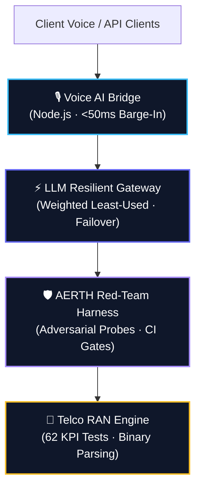

# Sergio Callier | Voice AI & Real-Time Systems Engineer — AI Systems Architect

### 💡 Engineering Vision & Systems Approach
Real-time AI systems engineer specializing in low-latency voice pipelines, multi-vendor LLM gateway resilience, and deterministic red-teaming evals. Built on 10+ years of carrier-grade access network engineering (Huawei 5G/4G RAN, RF, fiber). 

- **Production Latency Optimization:** Cut voice response latency from **20s to <1s** with **<50ms barge-in** interruption handling for field operations.
- **Resilient AI Gateways:** Designed zero-dependency weighted least-used key rotation pools (`RPM/RPD/TPM`) with multi-vendor failover (`Gemini → Groq → NVIDIA NIM`) and transparent SSE model masking.
- **Deterministic Evals & Red-Teaming:** Engineered automated adversarial evaluation harnesses blocking 4/4 attack categories in CI before production cutovers.
- **Carrier-Grade Failure Discipline:** Applied telecom SLA rigor to software systems, maintaining zero single-point-of-failure outages across distributed workflows.

---

## 🌟 Featured Engineering Showcases

| Repository | Focus & Architecture | Key Signals |
| :--- | :--- | :--- |
| 🎙️ **[realtime-voice-ai-bridge](https://github.com/SerjCallier/realtime-voice-ai-bridge)** | **Real-Time Voice AI Bridge & Ghost Tools** Node.js 20+ (0 runtime deps, 8/8 tests). Native HTTP/WS server, O(1) 64KB Mu-Law LUT DSP (`p95 0.03ms/frame`), `<50ms` barge-in buffer clear, non-blocking Ghost Tools & Twilio/Telnyx failover. |  `0 deps` `p95 0.03ms` |
| ⚡ **[llm-resilient-rotate-gateway](https://github.com/SerjCallier/llm-resilient-rotate-gateway)** | **Resilient Multi-Vendor LLM Gateway** Node.js 20+ ESM (0 runtime deps, 9/9 tests). OpenAI-compatible HTTP/SSE server, weighted `RPM/RPD/TPM` rotation, Pacific midnight / 60s / 5s cooldowns, `Gemini → Groq → NVIDIA` failover & SSE masking. |  `p50 0.019ms` `0 deps` |
| 🛡️ **[agent-evals-redteam-harness](https://github.com/SerjCallier/agent-evals-redteam-harness)** | **AERTH — AI Agent Evals & Red-Teaming Harness** Python 3.12, FastAPI, Pydantic v2, Pytest. Deterministic tool-calling accuracy, latency benchmarking, and 4/4 adversarial probe categories blocked in CI. |  `4/4 blocked` `Python 3.12` |
| 📡 **[telco-ran-ai-engine](https://github.com/SerjCallier/telco-ran-ai-engine)** | **AI Telco RAN Diagnostic Engine** Python 3.12, FastAPI, Pytest (62 automated tests passing). Deterministic 4G/5G RAN KPI diagnostics & runbook retrieval via PE MZ binary header validation + BM25 search. |  `62 tests` `5G/4G RAN` |

### 🛠️ Supporting Engineering Repositories
- **[AI-Systems-Architecture-Showcase](https://github.com/SerjCallier/AI-Systems-Architecture-Showcase):** Async Google Maps Puppeteer scraper, n8n automation pipelines, and Slack/Zoom CommIntel MCP integration.
- **[ai-system-builder-showcase](https://github.com/SerjCallier/ai-system-builder-showcase):** AI Revenue Attribution & Lead Analytics Engine (Async Python + LiteLLM + PostgreSQL).
- **[klierbook](https://github.com/SerjCallier/klierbook):** Zero-subscription SaaS booking engine (React 19 + n8n + Google Sheets API).

---

## 🛠️ Core Tech Stack

| Layer | Technologies |
| :--- | :--- |
| **Real-Time & Voice** | Node.js 20+ (ESM, Native WebSockets, Audio DSP), Twilio / Telnyx Media Streams, VAD Buffer Management |
| **Backend & APIs** | Python 3.12 (FastAPI, Pydantic v2), Node.js (HTTP/REST), PostgreSQL, Supabase, SQLite / FTS5 |
| **AI Infrastructure** | Gemini Live, Anthropic Claude, Groq, NVIDIA NIM, LiteLLM, Multi-Provider Failover, SSE Stream Rewriting |
| **Testing & Evals** | Pytest, `node --test`, GitHub Actions CI/CD, AERTH Red-Teaming Harness |
| **Telecom & RF** | Huawei 5G NR / 4G LTE RAN, GENEX Probe/Assistant, PE MZ Binary Parsing, Fiber Optic HFC / FTTH |

---

## 📬 Contact & Links

- 💼 **LinkedIn:** [linkedin.com/in/sergio-callier-578b71a3](https://www.linkedin.com/in/sergio-callier-578b71a3)
- 📧 **Email:** [callier.sergio@gmail.com](mailto:callier.sergio@gmail.com)
- 🐙 **GitHub:** [github.com/SerjCallier](https://github.com/SerjCallier)

---

🇦🇷 Versión en Español

## 🚀 Sergio Callier | Ingeniero de Sistemas Voice AI & Tiempo Real — Arquitecto de Sistemas IA

Ingeniero de sistemas de IA en tiempo real especializado en tuberías de voz de baja latencia, resiliencia de gateways LLM multi-proveedor y evaluación determinista de red-teaming. Fundamentado en más de 10 años de ingeniería en redes de acceso de telecomunicaciones (Huawei 5G/4G RAN, RF, fibra óptica).

### 💡 Logros Destacados
- **Optimización de Latencia en Voz:** Reducción de latencia de respuesta de **20s a <1s** con manejo de interrupción (*barge-in*) **<50ms**.
- **Gateways de IA Resilientes:** Rotación ponderada `RPM/RPD/TPM` con cero dependencias, cooldowns por zona horaria y failover entre proveedores (`Gemini → Groq → NVIDIA`).
- **Red-Teaming y Evals Deterministas:** Harness de evaluación con 4/4 categorías de ataques bloqueadas en CI.
- **Disciplina de Telecomunicaciones:** Rigor de SLA de carrier aplicado al diseño de sistemas de software.

